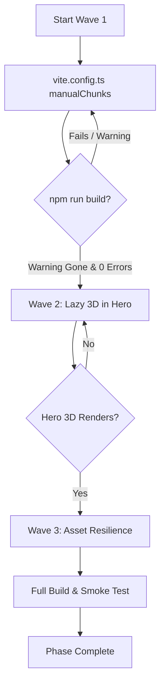

# Implementation Plan: Phase 2 — Bundle Optimization & Asset Resilience

**Phase:** Phase 2 — Bundle Optimization & Asset Resilience  
**Milestone:** M1 — Baseline Stabilization & Codebase Consolidation  
**Status:** Planned  
**Generated:** 2026-10-11  

---

## 1. Objectives & Success Criteria

1. **Eliminate Vite 500 kB+ Monolithic Chunk Warning**:
   - Break down `dist/assets/index-*.js` (1.25 MB) into modular vendor chunks (`vendor-three`, `vendor-animation`, `vendor-react`, `vendor-icons`).
   - Keep entry bundle size below 200 kB for fast initial paint.
2. **Asynchronous 3D Scene Loading**:
   - Dynamic import for `SceneCanvas` in `src/components/Hero.tsx` using `React.lazy()` and `Suspense`.
   - Provide an atmospheric glassmorphic pulse placeholder while WebGL shaders initialize.
3. **Asset Resilience & Error Handlers**:
   - Ensure image tags in project cards and micro-site galleries have graceful fallback handlers if external Unsplash URLs fail or are blocked.
4. **Zero Regressions**:
   - `npm run build` runs cleanly with 0 TypeScript/Rollup errors.
   - Interactive 3D glass physics, shatter triggers, and navigation continue operating without degradation.

---

## 2. Wave Execution Plan

### Wave 1: Rollup Chunk Splitting (Tracer Slice)
- **Files Modified**: [vite.config.ts](file:///c:/Projects/LensCraft_Photography_Website_Demo/lenscraft-photography-website/vite.config.ts)
- **Tasks**:
  1. Update `vite.config.ts` with `build.rollupOptions.output.manualChunks`:
     - Group `three`, `@react-three/fiber`, `@react-three/drei` into `vendor-three`.
     - Group `framer-motion`, `gsap` into `vendor-animation`.
     - Group `lucide-react` into `vendor-icons`.
     - Group `react`, `react-dom` into `vendor-react`.
  2. Run `npm run build` to confirm multiple separate chunk files are created and the monolithic 1.25 MB chunk warning is resolved.

### Wave 2: Asynchronous Lazy Loading for 3D Hero
- **Files Modified**: [src/components/Hero.tsx](file:///c:/Projects/LensCraft_Photography_Website_Demo/lenscraft-photography-website/src/components/Hero.tsx)
- **Tasks**:
  1. Convert `import { SceneCanvas } from './3d/SceneCanvas'` to dynamic `React.lazy()` import.
  2. Implement an elegant, lightweight glass placeholder in `<Suspense fallback={...}>` with animated pulse glow matching the neon theme.
  3. Ensure `onShatterStateChange` callback passes through seamlessly once loaded.

### Wave 3: Image Resilience & Fallback Handling
- **Files Modified**: [src/components/Projects.tsx](file:///c:/Projects/LensCraft_Photography_Website_Demo/lenscraft-photography-website/src/components/Projects.tsx)
- **Tasks**:
  1. Add `onError` handler to project showcase cards to display a styled radial mesh background with category icon if image loading fails.
  2. Verify all image tags have proper `loading="lazy"` and `decoding="async"` attributes.

---

## 3. Verification Gates

1. **Gate 1 (Build Cleanliness)**: `npm run build` finishes with exit code 0 and no oversized chunk warnings.
2. **Gate 2 (Bundle Profile)**: Main entry bundle < 200 kB; 3D chunk isolated.
3. **Gate 3 (Interactive Smoke Test)**: 3D canvas loads and responds to pointer gestures; shattered sphere triggers remain functional; project links open corresponding sub-sites.

---

## 4. Rollback Plan

- If Rollup manualChunks configuration causes runtime circular dependency issues between Drei and Fiber, roll back `vite.config.ts` via `git checkout vite.config.ts`.
- If dynamic lazy import affects Three.js context initialization, revert `Hero.tsx` to synchronous import.
